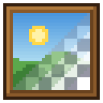
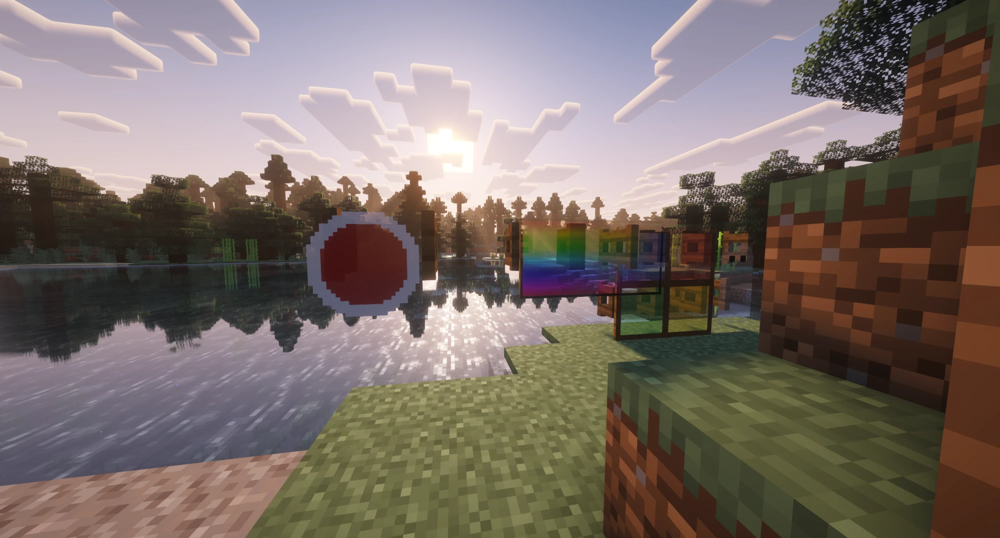
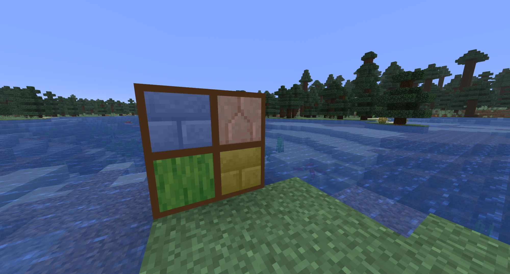
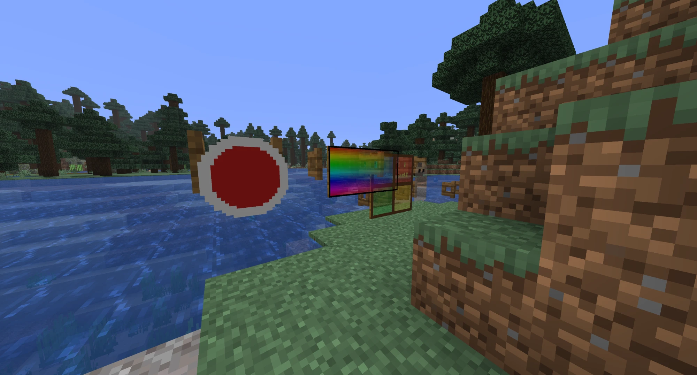

<p align="center"></p>

# Transparent Paintings

A small client-side Fabric mod for Minecraft **26.3** that lets paintings use transparent and semi-transparent pixels.

Vanilla draws paintings with a solid render type, so the alpha channel of painting textures is ignored. With this mod, any painting whose texture contains non-opaque pixels is drawn with a translucent render type instead. Fully opaque paintings are left exactly as vanilla draws them.



## Features

- **Automatic:** no config. A painting is switched to translucent rendering only if its texture has at least one non-opaque pixel.
- **Semi-transparency:** alpha from 0 to 255 is respected, not just on/off cutout.
- **Clean edges:** the sides of a painting are only drawn where the image border is at least 50% opaque, so a round painting doesn't get a square frame.
- **Client-side only:** works on vanilla, Paper or Fabric servers. The server doesn't need the mod.
- **Works with custom paintings:** add painting variants with a datapack and textures with a resource pack, as usual. Nothing mod-specific is needed in either pack.
- **No dependencies**, not even Fabric API. Tested with Sodium, Iris and Complementary Reimagined.

| Stained window | Clean edges |
|---|---|
|  |  |

## Making transparent paintings

1. Datapack: `data/<namespace>/painting_variant/<name>.json`, for example:
   ```json
   { "asset_id": "<namespace>:<name>", "width": 2, "height": 1 }
   ```
2. Resource pack: `assets/<namespace>/textures/painting/<name>.png`, a PNG with an alpha channel.

Vanilla paintings can be made transparent too, by overriding their textures in a resource pack.

The back of the painting keeps the vanilla back texture. Looking through the transparent front, you see the wall behind it. Animated textures use their first frame to decide which edges to draw.

Players without the mod see transparent pixels as opaque.

## Test packs

`testpacks/generate.ps1` builds a test datapack and resource pack containing six paintings: gradient, cutout, stained window, ghost, edge test and an opaque control.

```
powershell -ExecutionPolicy Bypass -File testpacks\generate.ps1
```

In game: `/give @s painting[painting/variant="tptest:window"]` (also `gradient`, `cutout`, `ghost`, `edges`, `opaque`).

## Building

Requires JDK 25.

```
./gradlew build
```

The jar is in `build/libs/`. `./gradlew runClient` starts a dev client with Sodium and Iris.

The `publish/` folder holds the Modrinth page text, changelog, gallery and icon generator.

## Credits

Inspired by [Just Make Paintings Transparent](https://github.com/lumiscosity/jumapat) and [Paintings Need Glass](https://github.com/Antik16384/paintingsneedglass), both MIT.

## License

MIT
